<a href="https://github.com/PANYAMHEMANTH/PANYAMHEMANTH">
  
</a>

<div align="center">

  <a href="https://git.io/typing-svg">
    
  </a>

</div>

<p align="center">
   <a href="https://www.credly.com/users/hemanth-panyam.17aabd1e/" target="_blank">
     
  </a>&nbsp;&nbsp;
   <a href="https://discord.com/users/1080769912454270977" target="_blank">
    
  </a>&nbsp;&nbsp;
  <a href="https://www.linkedin.com/in/hemanth-panyam/" target="_blank">
    
  </a>&nbsp;&nbsp;
  <a href="mailto:panyamhemanth2005@gmail.com" target="_blank">
    
  </a>&nbsp;&nbsp;
  <a href="https://github.com/PANYAMHEMANTH/" target="_blank">
    
  </a> &nbsp;&nbsp;
  <a href="https://leetcode.com/u/Hemanth_0000/" target="_blank">
    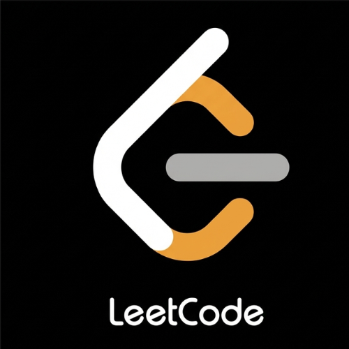
  </a>
</p>

<br/>

---

### ⚡ The Developer "Beat"

I am an **SDE** with **2+ years of experience** designing and delivering production-grade applications used by **1,000+ users**. My expertise spans **MERN** and **PERN** ecosystems, distributed systems, cloud infrastructure, and event-driven architectures. I hold the **AWS Certified CloudOps Engineer – Associate** certification and the **Microsoft Certified: SQL AI Developer Associate** certification.

- 🎓 **Education:** Pursuing a B.Tech in Engineering at G. Pullaiah College of Engineering & Technology, Kurnool
- 🏢 **Professional Experience:**
  - **RMJ IT Solutions** *(Jul 2024 – Present):* Building enterprise learning platforms with HLS streaming, Apache Kafka, virtual labs, and crypto payment integrations
  - **Google Virtual Internship** *(Jan–Mar 2025):* Developed React applications using Agile delivery practices and supported live client deployments
  - **Google Virtual Internship** *(Oct–Dec 2024):* Completed six skill badges across cloud, TensorFlow, Android, and web development
  - **RMJ IT Solutions – PHP/MySQL** *(Nov 2023 – May 2024):* Developed CMS platforms, administrative dashboards, and student grade-management systems
- 🏅 **Certifications:** AWS Certified CloudOps Engineer – Associate · Microsoft Certified: SQL AI Developer Associate
- 💻 **Current Focus:** Scalable LMS architecture, HLS adaptive streaming, Apache Kafka pipelines, AWS cloud operations, and secure payment systems
- 🧠 **Areas of Interest:** Cloud-native development, distributed systems, blockchain, healthcare technology, cybersecurity, and AI-enabled applications

<br clear="all"/>

---

### 🛠️ Tech Arsenal

<div align="center">

<p><b>Languages & Frameworks</b></p>

<a href="" title="JavaScript"></a>
<a href="" title="TypeScript"></a>
<a href="" title="React"></a>
<a href="" title="Next.js"></a>
<a href="" title="Node.js"></a>
<a href="" title="Express.js"></a>
<a href="" title="Python"></a>
<a href="" title="Java"></a>
<a href="" title="PHP"></a>
<a href="" title="HTML"></a>
<a href="" title="CSS"></a>
<a href="" title="Tailwind CSS"></a>
<a href="" title="Material UI"></a>

<br/><br/>

<p><b>Databases, Messaging & Cloud</b></p>

<a href="" title="MongoDB"></a>
<a href="" title="PostgreSQL"></a>
<a href="" title="MySQL"></a>
<a href="" title="Apache Kafka"></a>
<a href="" title="Redis"></a>
<a href="" title="AWS"></a>
<a href="" title="Google Cloud"></a>
<a href="" title="Docker"></a>
<a href="" title="Git"></a>
<a href="" title="GitHub"></a>
<a href="" title="Linux"></a>
<a href="" title="Postman"></a>
<a href="" title="Grafana"></a>
<br/>
</div>

---

### 🚀 Key Projects

| 🏆 Project | 🛠️ Stack | 📝 Detail |
| :--- | :--- | :--- |
| **Learning Management System** | PERN · Kafka · HLS | 1000+ active users · HLS adaptive streaming · Multi-language · SaferPay & Cryptomus payments · Virtual Labs (Ludus Cloud) · Kafka real-time events |
| **MeetoCure** | MERN Stack | Real-time doctor appointment platform · Secure auth · Appointment reminders · Responsive healthcare UI |
| **Automated Timetable System** | MERN + Algorithms | Intelligent conflict-free scheduling for faculty & students |
| **E-Commerce Platform** | MERN + Stripe | Cart & order management · Stripe payments · Responsive design |
| **College Portal** | MERN | Course/event management · Admin dashboard · Notifications |
| **VulnHub to AWS Migration** | Cloud / AWS | Converted VulnHub OVA → AWS AMI for isolated multi-user VM deployment on EC2 |
| **CMS & Student Marking Dashboard** | PHP / MySQL | Dynamic content & grade management system |

---

### 💼 Experience Timeline

```
Jul 2024 – Present  │ MERN/PERN Stack Developer Intern       │ RMJ IT Solutions · Kurnool (On-site)
Oct 2024 – Dec 2024 │ Google Virtual Developer Intern        │ Google for Developers (Remote)
Nov 2023 – May 2024 │ Full Stack Intern (PHP & MySQL)        │ RMJ IT Solutions · Kurnool (On-site)
```

---

### 🏆 Coding Stats & Certifications

<div align="center">

<a href="https://leetcode.com/u/Hemanth_0000/"></a>

<br/><br/>

<p><b>✨ Verified Certifications ✨</b></p>

---

**🎯 Associate Level**

<table align="center" style="border-collapse: separate; border-spacing: 24px 12px;">
  <tr>
    <td style="padding: 12px;"><a href="https://www.credly.com/badges/7d775ad7-33f3-42d3-bf83-df54ff970903/public_url" title="AWS Certified CloudOps Engineer – Associate">    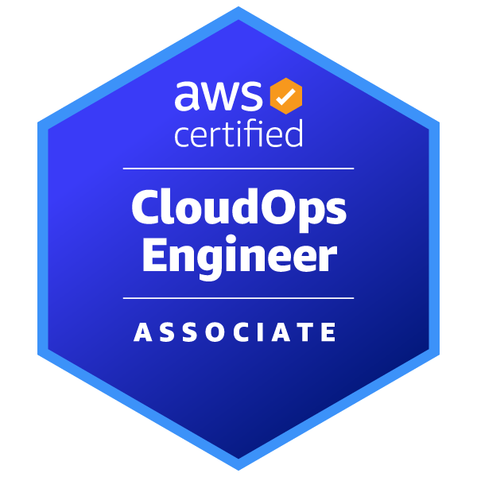</a></td>
    <td style="padding: 12px;"><a href="https://learn.microsoft.com/api/credentials/share/en-us/panyam-hemanth/3A3049609056FC58?sharingId=72DE55B83B397498" title="Microsoft Certified: SQL AI Developer Associate"></a></td>
  </tr>
</table>

<br/><br/>

**🎓 Global & University Certifications**

<a href="https://drive.google.com/file/d/1wQqlkOn5TsSf6JXJYmuo6FKVluSvUp6h/view?usp=sharing" title="Cambridge Linguaskill English Certification">

</a>&nbsp;&nbsp;
<a href="https://developers.google.com/profile/u/panyamhemanth" title="Google for Developers – 6 Skill Badges">
  
</a>&nbsp;&nbsp;
<a href="https://cs50.harvard.edu/certificates/87732942-8b2b-4e17-a9c6-07c370bd8c51" title="Harvard CS50: Introduction to Computer Science">
  
</a>

<br/><br/>

**🏅 Additional Professional Badges**

<table align="center" style="border-collapse: separate; border-spacing: 24px 12px;">
  <tr>
    <td style="padding: 12px;">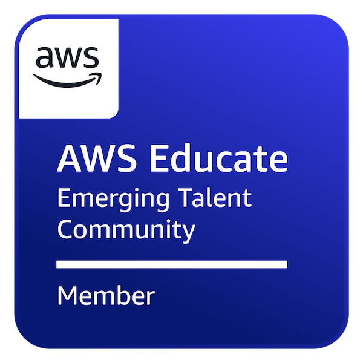</td>
    <td style="padding: 12px;"><a href="https://www.credly.com/badges/c3554690-b957-41a4-b475-6ba394d32ab0/public_url" title="AWS Knowledge: Amazon EKS Training">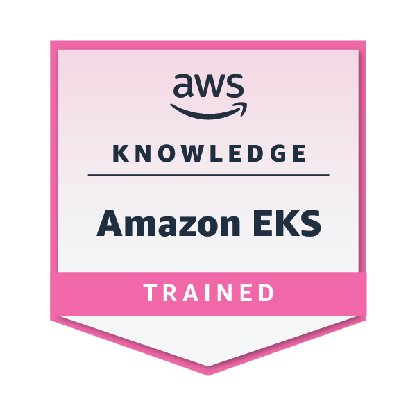</a></td>
    <td style="padding: 12px;"><a href="https://www.credly.com/badges/2103ab1d-37ed-49fd-a419-ff01e9dbfb2e/public_url" title="Red Hat AI Foundations Executive Skills Badge">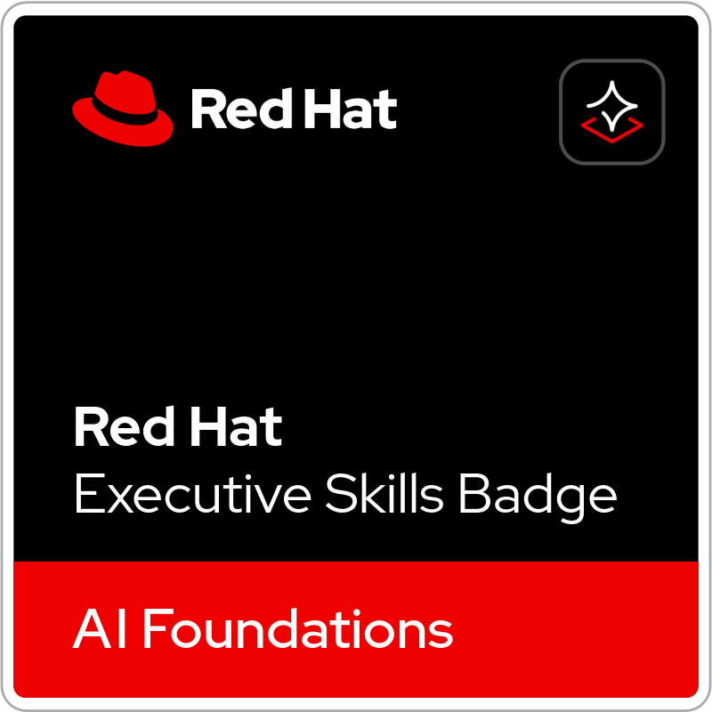</a></td>
  </tr>
</table>

<br/><br/>

**☁️ Google Cloud Badges**

<table align="center" style="border-collapse: separate; border-spacing: 18px 12px;">
  <tr>
    <td style="padding: 12px;">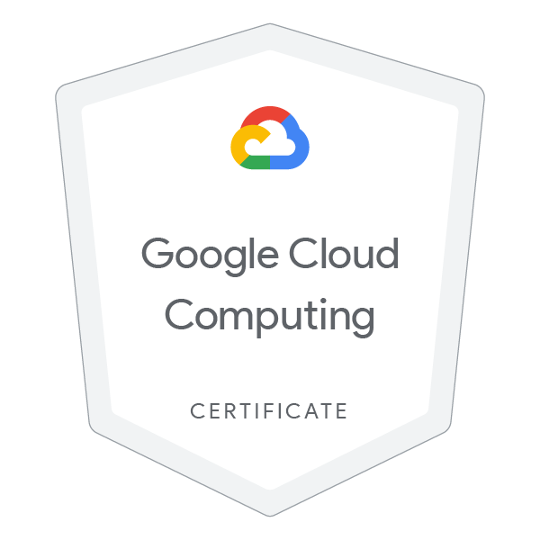</td>
    <td style="padding: 12px;"></td>
    <td style="padding: 12px;">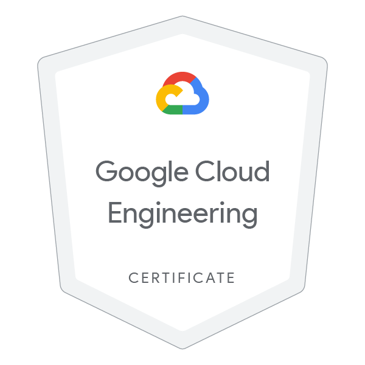</td>
  </tr>
  <tr>
    <td style="padding: 12px;"></td>
    <td style="padding: 12px;"></td>
    <td style="padding: 12px;"></td>
  </tr>
</table>

<br/><br/>

**🐧 Linux Foundation Badges**

<table align="center" style="border-collapse: separate; border-spacing: 18px 12px;">
  <tr>
    <td style="padding: 12px;"></td>
    <td style="padding: 12px;">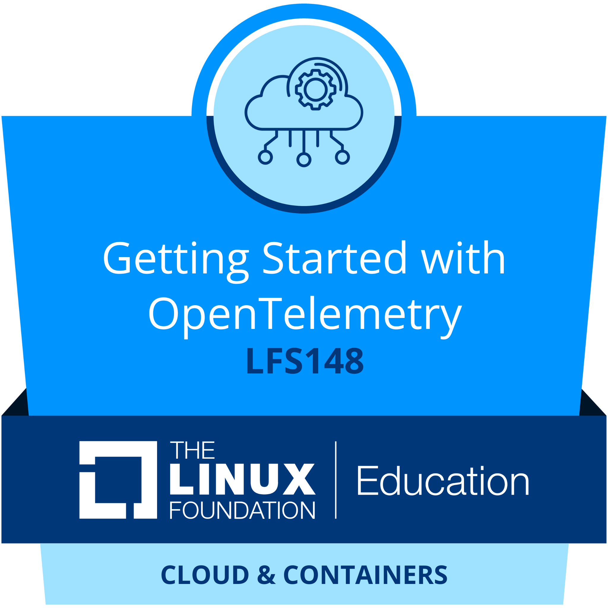</td>
    <td style="padding: 12px;"></td>
    <td style="padding: 12px;"></td>
  </tr>
  <tr>
    <td style="padding: 12px;"></td>
    <td style="padding: 12px;"></td>
    <td style="padding: 12px;"></td>
    <td style="padding: 12px;"></td>
  </tr>
</table>

<br/><br/>

---

**💻 Programming & Technical**

<br/>

<a href="https://www.hackerrank.com/certificates/7a347f3bb4e5" title="HackerRank – SQL Intermediate">

</a>&nbsp;&nbsp;<a href="https://leetcode.com/u/Hemanth_0000/" title="LeetCode Profile"></a>

<br/><br/>

<a href="https://www.udemy.com/certificate/UC-6f4f96a1-f1fc-4883-83f8-88bd2d0b8fb6/" title="Udemy – MERN Stack Development"></a>&nbsp;&nbsp;<a href="https://gpcet.codetantra.com/cert/certificate.jsp?certId=CT1564-uBX191H-c0n" title="Java Programming – CodeTantra / GPCET">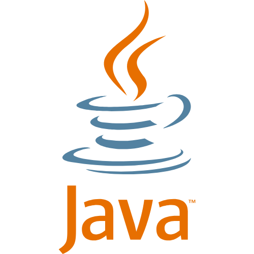</a>

<br/><br/>

---

**🏢 Internship Completions**

<br/>

<a href="https://drive.google.com/file/d/1_cePQ3tO3YgWWbXXMgrCUHux1GL94hWd/view?usp=drive_link" title="Google for Developers – Virtual Internship Completion"></a>

<br/><br/>

<a href="https://drive.google.com/file/d/1MOJUfrOxEK7LMrYxwcjAB_J0JyXCMl2v/view?usp=sharing" title="RMJ IT Solutions – Full Stack Development Completion"></a>

</div>

---

### 📊 GitHub Stats

<div align="center">


<br/><br/>

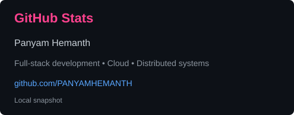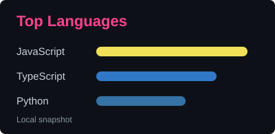

</div>

---

<div align="center">
  <picture>
    <source media="(prefers-color-scheme: dark)" srcset="./generated/snake-dark.svg">
    <source media="(prefers-color-scheme: light)" srcset="./generated/snake.svg">
    
  </picture>
</div>

---

<div align="center">
  
  <br/><br/>
  <sub><i>✅ Available Immediately &nbsp;•&nbsp; Open to Relocation &nbsp;•&nbsp; Full-Time & Remote Roles Welcome</i></sub>
  <br/>
  <sub><i>"Code is like humor. When you have to explain it, it's bad."</i></sub>
</div>
